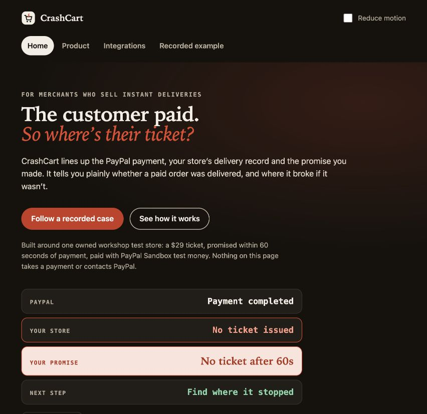

# CrashCart

**“I paid, but my ticket never arrived.”** CrashCart helps support and engineering at small online sellers find the missing step between payment and delivery.

## For judges

[Open the recorded demo](https://crashcart.52.202.25.181.sslip.io/) · [Watch the 2:45 video](https://www.youtube.com/watch?v=gFWje84_wEA) · [Pages mirror](https://himanshu748.github.io/crashcart/)

The public walkthrough replays saved records. **It makes no new PayPal or AI calls.** Compare a confirmed payment with a missing ticket, then see a repair deliver exactly one ticket inside the same 60-second promise.

### Try it in 60 seconds

Python 3.11+ is required; Python 3.13.15 is tested. No packages, account keys or licence are needed.

```sh
git clone https://github.com/himanshu748/crashcart.git
cd crashcart
./scripts/judge.sh
```

Expected output:

```text
CrashCart recorded review: http://127.0.0.1:8766/demo.html#investigation
Both outcomes recomputed at launch. No new payment or service call.
Press Ctrl+C to stop.
```

Open the printed URL. Compare **Missed order** and **Recovered order (replay)**. Stop with Ctrl+C. For a terminal without a browser, add `--no-open`.



## What actually happened

Three separate cases explain the product:

- **22 October:** a saved Sandbox payment completed, but its ticket was missing. The public repair comparison reuses this input; the healthy variant delivers at **32.26 seconds**, without a new purchase.
- **23 October:** an earlier checkout, investigated by AI on 26 October. Its saved AI steps concern a different case from the missed order.
- **8 November:** a real PayPal Sandbox **Orders v2 create/capture/get** flow and real DeepSeek calls through Modal. [Completed live flow](docs/LIVE_FLOW.md).

The AI proposes which payment and ticket records to inspect. **Deterministic code decides whether the delivery promise was kept.** It cannot infer delivery from a checkout success message.

## Reproduce both outcomes

```sh
python3 -m crashcart.replay run evidence/runs/paypal-live/early-response-loss-input.json --merchant defective
# exit 1: FAIL / paid_without_ticket / 0 tickets / network_calls=0
python3 -m crashcart.replay run evidence/runs/paypal-live/early-response-loss-input.json --merchant healthy
# exit 0: PASS / ticket_delivered_once_on_time / 1 ticket / network_calls=0
./scripts/test-judge.sh
```

The healthy replay applies the repaired fulfil-on-confirmed-reconciliation rule to the same recorded input; it does not re-run `MerchantService`.

The defective command intentionally exits 1. Both variants use the unchanged payment input and 60-second rule. The separate original late-read tape still fails correctly; it has not been rewritten to manufacture a pass.

## Run your own Sandbox checkout

This is a separate, private workspace, using your own test accounts and authorized model access. Never use a real-money buyer or publish keys. [Full setup and test-buyer instructions](docs/JUDGE_GUIDE.md) · [Secret-free environment example](.env.example).

```sh
python3 -m crashcart setup
# Privately configure .env before continuing.
python3 -m crashcart migrate
python3 -m crashcart serve
# In another terminal:
python3 -m crashcart worker
```

Required: `CRASHCART_OPERATOR_TOKEN`, `PAYPAL_CLIENT_ID`, `PAYPAL_CLIENT_SECRET`, `CRASHCART_PUBLIC_URL`, `CRASHCART_ALLOW_SANDBOX=1`, `CRASHCART_ALLOW_MODEL=1`. For Modal/DeepSeek, set `CRASHCART_MODEL_PROVIDER=modal`, `MODAL_API_KEY`, `MODAL_MODEL`, `MODAL_BASE_URL`, and the identical `MODAL_ALLOWED_ORIGIN`. The optional OpenAI adapter instead uses `OPENAI_API_KEY` and `OPENAI_MODEL`.

Open the workspace, approve a test checkout with your Sandbox Personal buyer, confirm payment, wait past the promise, and choose **Check payment and delivery**, then **Ask the assistant**. New calls need your provider allowance; they do not occur on the public demo.

## What powers it

| Technology | Actual job |
| --- | --- |
| PayPal Sandbox REST | Creates and captures test orders, independently reads payment status, verifies webhook signatures. Public pages show saved observations. |
| Modal + DeepSeek | Selects the next evidence to inspect in bounded investigations. The 8 November run used three real model requests. |
| AG Studio 3.0.0 | Optional records workspace: five evidence panels and native Agent Framework. A recorded explorer is being prepared on this feature branch; it is **not deployed**. [Access and licensing](docs/studio.md). |
| Bryntum Community Scheduler | Actual MIT-licensed delivery-timing view in the full workspace and video at 2:10–2:20. |
| KERNEL | Remote test-checkout browser sessions and recordings in earlier authorized experiments. |
| Postman / Newman | Executable API and linked-record checks. |

The keyless path needs none of these service keys. Sponsor eligibility is separate from an installed package. [Integration scope](docs/sponsor-ledger.md).

## Optional workspace

[Full workspace and delivery timing](docs/WORKSPACE.md) · [Records explorer](docs/studio.md) · [Merchant monitoring preview](docs/MONITOR_SETUP.md)

Shopify and WooCommerce connectors have local signed-event tests, but **no real merchant store is connected yet**. Merchant onboarding and production payments remain future work.

## Project and submission

[MIT licence](LICENSE) covers CrashCart’s source; vendor packages retain their own terms. [Health and restart](docs/OPERATIONS.md) · [Architecture](docs/architecture.md) · [Replay details](docs/replay.md).

[Devpost entry](https://devpost.com/software/crashcart-87asqz), submitted 10 November 2026 · [Submission text](docs/DEVPOST.md) · [Video script](docs/VIDEO_SCRIPT.md).

Historical development checklists are in [docs/archive](docs/archive/STATUS.md). They describe internal work and do not change the recorded demo’s scope. [Sponsor preparation log](docs/SPONSOR_PRIZE_RUN_LOG.md).
