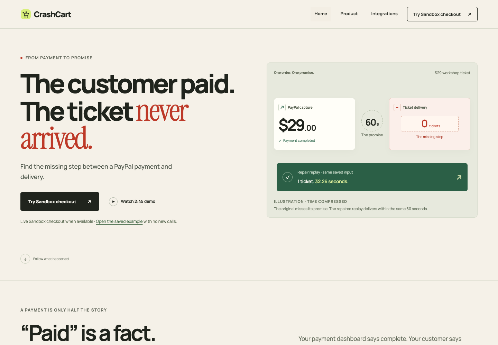

# CrashCart

**“I paid, but my ticket never arrived.”** CrashCart helps support and engineering at small online sellers find the missing step between payment and delivery.

## For judges

[Open the recorded demo](https://crashcart.32.193.44.79.sslip.io/) · [Watch the 2:45 video](https://www.youtube.com/watch?v=3MIzDpFmRl0) · [Pages mirror](https://himanshu748.github.io/crashcart/)

**Mode:** the public walkthrough is a **Saved replay** of the 8 November investigation. The optional **Live sandbox** page starts a new fake-money checkout only when enabled. The local build below recomputes the separate 22 October repair comparison.

### Optional live Sandbox checkout

[Open the Sandbox purchase page](https://crashcart.32.193.44.79.sslip.io/live.html). If live runs are enabled, choose **Run a live Sandbox purchase**, approve the USD29 test checkout, and return to see the signed payment notification, cited investigation and delivery result. When paused or unavailable, the page displays the saved comparison.

Dedicated **fake-money Sandbox buyer**, created only for judges and verified by sign-in on 12 November (never use this account at real PayPal):

```text
Email: sb-7leov53854706@personal.example.com
Password: Fz$kA>5B
Sign-in: https://www.sandbox.paypal.com/
```

These are intentionally shared Sandbox-only test credentials, not merchant app keys. Live testing is limited to three starts per IP per hour, eight starts per day and eight starts for the authorized window; each investigation is capped at three model calls. A verified new checkout and investigation are distinct from the saved walkthrough. [Operator setup, limits and rollback](docs/PUBLIC_LIVE_HOST_PLAN.md).

### Try it in 60 seconds

Python 3.11+ is required; Python 3.13.15 is tested. No packages, account keys or licence are needed.

```sh
git clone https://github.com/himanshu748/crashcart.git
cd crashcart
./scripts/judge.sh
```

Expected output:

```text
CrashCart recorded review: http://127.0.0.1:8766/demo.html#investigation
Both outcomes recomputed at launch. No new payment or service call.
Press Ctrl+C to stop.
```

The local command opens the **22 October repair comparison**; the hosted demo opens the **8 November investigation**. Both are available in Saved cases. Choose **Missed order** or **Recovered order (replay)** to compare the same recorded payment under two merchant rules. Stop with Ctrl+C. For a terminal without a browser, add `--no-open`.



## What actually happened

Two cases explain the product:

- **8 November — investigation:** a real PayPal Sandbox **Orders v2 create/capture/get** flow and real DeepSeek calls through Modal found a completed payment with no ticket. [Completed live flow](docs/LIVE_FLOW.md).
- **22 October — repair comparison:** an earlier recorded payment supplies both faulty and repaired replays. The repaired rule delivers one ticket at **32.26 seconds**. It is a different order from the November investigation.

Earlier investigations remain available in [the workspace history](docs/WORKSPACE.md#earlier-recorded-investigation).

The AI proposes which payment and ticket records to inspect. **Deterministic code decides whether the delivery promise was kept.** It cannot infer delivery from a checkout success message.

## Reproduce both outcomes

```sh
python3 -m crashcart.replay run evidence/runs/paypal-live/early-response-loss-input.json --merchant defective
# exit 1: FAIL / paid_without_ticket / 0 tickets / network_calls=0
python3 -m crashcart.replay run evidence/runs/paypal-live/early-response-loss-input.json --merchant healthy
# exit 0: PASS / ticket_delivered_once_on_time / 1 ticket / network_calls=0
./scripts/test-judge.sh
```

The healthy replay applies the repaired fulfil-on-confirmed-reconciliation rule to the same recorded input; it does not re-run `MerchantService`.

The defective command intentionally exits 1. Both variants use the unchanged payment input and 60-second rule. The separate original late-read tape still fails correctly; it has not been rewritten to manufacture a pass.

## Run your own Sandbox checkout

This is a separate, private workspace, using your own test accounts and authorized model access. Never use a real-money buyer or publish keys. [Full setup and test-buyer instructions](docs/JUDGE_GUIDE.md) · [Secret-free environment example](.env.example).

```sh
python3 -m crashcart setup
# Privately configure .env before continuing.
python3 -m crashcart migrate
python3 -m crashcart serve
# In another terminal:
python3 -m crashcart worker
```

Required: `CRASHCART_OPERATOR_TOKEN`, `PAYPAL_CLIENT_ID`, `PAYPAL_CLIENT_SECRET`, `CRASHCART_PUBLIC_URL`, `CRASHCART_ALLOW_SANDBOX=1`, `CRASHCART_ALLOW_MODEL=1`. For Modal/DeepSeek, set `CRASHCART_MODEL_PROVIDER=modal`, `MODAL_API_KEY`, `MODAL_MODEL`, `MODAL_BASE_URL`, and the identical `MODAL_ALLOWED_ORIGIN`. The optional OpenAI adapter instead uses `OPENAI_API_KEY` and `OPENAI_MODEL`.

Open the workspace, approve a test checkout with your Sandbox Personal buyer, confirm payment, wait past the promise, and choose **Check payment and delivery**, then **Ask the assistant**. New calls need your provider allowance; they do not occur on the public demo.

### Sandbox buyer for a judge’s own run

Use a **PayPal Sandbox Personal account**, not a real-money PayPal account. Create
one under Developer dashboard → Testing tools → Sandbox accounts, or use a
separately supplied test buyer. Keep its password and the merchant app secret
outside Git. The saved replay needs no buyer or credentials; the dedicated hosted test buyer above is separate from your own merchant app.

```text
Sandbox buyer email: <YOUR_SANDBOX_PERSONAL_EMAIL>
Sandbox buyer password: <YOUR_SANDBOX_PERSONAL_PASSWORD>
Merchant Sandbox app: <YOUR_SANDBOX_CLIENT_ID> / <YOUR_SANDBOX_CLIENT_SECRET>
```

The timing page starts with the saved comparison. **Load my Sandbox cases** reads
only checkouts belonging to the current browser session when the live workspace
is enabled; static mirrors retain the saved comparison. Reading that view never
starts a payment or an AI investigation, and automatic status refresh stops
after eight minutes. A new checkout requires your Sandbox buyer and provider
allowance; use the keyless path above to inspect the recorded outcomes.

## What powers it

| Technology | Actual job |
| --- | --- |
| PayPal Sandbox REST | Creates and captures test orders, independently reads payment status, verifies webhook signatures. Public pages show saved observations. |
| Modal + DeepSeek | Selects the next evidence to inspect in bounded investigations. The 8 November run used three real model requests. |
| AG Studio 3.0.0 | Optional local records workspace with five evidence panels and Agent Framework. **Not part of the public submission experience or selected sponsor claim.** [Local setup and terms](docs/studio.md). |
| Bryntum Community Scheduler | Actual MIT-licensed delivery-timing view in the video at 2:10–2:20 and the [keyless recorded timing page](https://crashcart.32.193.44.79.sslip.io/timing.html). |
| KERNEL | Remote test-checkout browser sessions and recordings in earlier authorized experiments. |
| Postman / Newman | Executable API and linked-record checks. |
| Deepgram Aura-2 Thalia | English narration in the current 2:45 video; not the in-product investigator. |

The keyless path needs none of these service keys. Sponsor eligibility is separate from an installed package. [Integration scope](docs/sponsor-ledger.md).

## Optional workspace

[Full workspace and delivery timing](docs/WORKSPACE.md) · [Records explorer](docs/studio.md) · [Merchant monitoring preview](docs/MONITOR_SETUP.md)

Shopify and WooCommerce connectors have local signed-event tests, but **no real merchant store is connected yet**. Merchant onboarding and production payments remain future work.

## Path to production

This prototype uses the PayPal **Sandbox** base URL and a fixed **2,900-cent USD ticket fixture**. Production needs a separately reviewed PayPal live app/base URL, merchant-owned catalog and fulfilment contracts, verified store onboarding, and per-user/store access with expiry and revocation. The legacy operator cookie has no server expiry; the new public Sandbox session expires after two hours. Webhook timestamps are parsed without an age window, and duplicates are keyed by event ID. [Existing boundaries and required changes](docs/SECURITY_BOUNDARIES.md). No production payment or real merchant connection is claimed.

## Project and submission

[MIT licence](LICENSE) covers CrashCart’s source; vendor packages retain their own terms. [Health and restart](docs/OPERATIONS.md) · [Architecture](docs/ARCHITECTURE.md) · [Replay details](docs/replay.md).

[Devpost entry](https://devpost.com/software/crashcart-87asqz), submitted 10 November 2026 · [Submission text](docs/DEVPOST.md) · [Video script](docs/VIDEO_SCRIPT.md).

Historical development checklists are in [docs/archive](docs/archive/STATUS.md). They describe internal work and do not change the recorded demo’s scope. [Sponsor preparation log](docs/SPONSOR_PRIZE_RUN_LOG.md).

[Repository guidance](docs/AGENTS.md) lives under `docs/`; load it explicitly when working on this repository.
