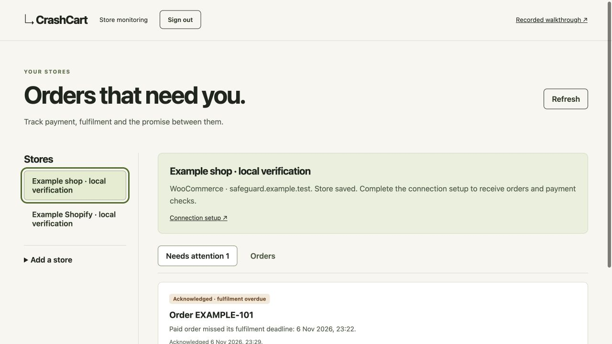

# CrashCart

**A successful payment should lead to a fulfilled order.**

“I paid, but nothing arrived.” For a small shop, that message means searching
payment records, order history and fulfilment updates while a customer waits.
CrashCart brings those pieces together so the missing step is easier to find.

**[Open CrashCart →](https://crashcart.52.202.25.181.sslip.io/)** · [Run it locally](#run-it-locally)
No account needed. Follow a recorded $29 ticket purchase from payment to the
missing ticket, then compare the repaired checkout. The hosted demo shows results
computed during export; the local command recomputes them at startup.

## Judge access

The [current HTTPS demo](https://crashcart.52.202.25.181.sslip.io/) runs without an account.
Hosting is optional under the event rules; `./scripts/judge.sh` below is the local
alternative. The [older Pages preview](https://himanshu748.github.io/crashcart/)
remains a fallback. The local command
recomputes the two merchant outcomes from saved Sandbox input, without new
payment or AI calls. The full configured PayPal-plus-AI workspace has separate
access requirements.

Submissions close **13 November 2026, 01:30 IST**. Keep the demonstrated build and
required credentials/trials through the **21 December winner announcement**; plan
retention through **22 December UTC**. Freeze submitted source, video and linked
materials after the deadline until the announcement. The private AG Studio trial
ends 17 December and does not cover that window; the keyless path needs no licence.
[Current readiness and remaining gaps](docs/RULES_READINESS.md).

The configured workspace also completed a **new Sandbox checkout and real AI
investigation on 8 November**: PayPal confirmed the $29 capture, DeepSeek checked
payment and ticket records in three calls, and CrashCart identified the missing
ticket. [See the actual local flow and its limits](docs/LIVE_FLOW.md). This
execution is separate from the account-free hosted replay.

A [protected hosting candidate](deploy/live/README.md) is prepared for that
connected workflow on the existing host. Its local tests and secret-free
container checks are recorded; it has **not been activated**, and no provider
credentials have been uploaded. Activation requires approval to change the
recorded-only hosting scope and extend the bounded model allowance.

## See what happened

The example starts with a simple promise: **one workshop ticket within 60
seconds of payment**. PayPal confirms the payment, but the store loses its reply
and never delivers the ticket. CrashCart puts the payment and ticket records
side by side. The repaired checkout checks again and delivers one ticket within
the same deadline.

Explore the failed checkout, switch to its repair and follow the timeline.
The records and an executable replay are available if you want to look closer.
This is a recorded example, not a new payment or a live merchant connection.

<a id="try-the-product-in-60-seconds"></a>

## Run it locally

With Python 3.11 or newer:

```sh
git clone https://github.com/himanshu748/crashcart.git
cd crashcart
./scripts/judge.sh
```

It opens the comparison at <http://127.0.0.1:8766/#investigation>. No API keys,
PayPal login, vendor licence, Node installation or package download is needed.
Tested with Python **3.13.15**. Stop with **Ctrl+C**; use `--no-open` on a machine
without a desktop or `--port 8767` if the default port is busy.

The local command runs both checkout variants against the same saved inputs and
clock using CrashCart's payment and ticket rules. The hosted demo displays those
results computed at site-build time. Neither path makes new payments or model
calls. The original faulty-checkout video is unavailable; the saved page and
payment observations are included. See [replay details](#reproduce-the-comparison)
for the commands and [the recorded AI investigation](docs/AI_EVIDENCE.md) for
the separate historical DeepSeek workflow. The current source build also presents that earlier case as an interactive payment → ticket → promise walkthrough. Its recorded order is separate from the faulty checkout; viewing it makes no new AI or payment call.

## A daily inbox for paid orders

The merchant monitoring preview extends that same idea across a store's orders:
bring payment, order and fulfilment facts together, flag a missed promise, and
keep the history when someone acknowledges or fulfils the order. Each store has
its own inbox and fulfilment deadline.



*Local example data; no real merchant store is connected yet.*

The preview has Shopify and WooCommerce webhook readers and store-scoped PayPal
Sandbox matching. So far it has been exercised with signed example events and
stubbed PayPal replies. Shopify still needs transaction data to match a payment;
its order webhook alone stays unmatched. “Fulfilled” means the merchant has
marked the order complete, not that a physical parcel has arrived.

With Python **3.13.15**, configure a private `CRASHCART_MONITOR_TOKEN` and run:

```sh
python3 -m crashcart.monitor_server --db var/monitor.sqlite3 --port 8790
```

Open <http://127.0.0.1:8790/>. [Connection setup](docs/MONITOR_SETUP.md) explains
the access key and per-store settings. This is a local preview for one operator
managing owned stores. Customer accounts, app installation and per-store billing
are still pending.

## What powers CrashCart

| Technology | Role in CrashCart |
| --- | --- |
| PayPal Sandbox | Test checkout and independent payment reads. The public demo uses saved observations. |
| AG Grid's AG Studio | Linked payment, ticket and browser views in the configured full workspace. Requires an applicable licence. |
| Bryntum Community Scheduler | Compares saved ticket timings with the delivery window in the full workspace. |
| KERNEL | Remote test-checkout browser sessions and recordings; separately configured and authorized. |
| Modal + DeepSeek | Selects payment and ticket observations in bounded investigations; the fresh local 8 November flow used three real requests. Modal is the model host, not a listed event sponsor. |
| Postman | Runnable API checks and linked-record checks; the local runner needs no Postman account. |

The account-free demo needs none of these service keys. The
[integration ledger](docs/sponsor-ledger.md) records the scope and current status
of each integration.

Check the keyless example with `./scripts/test-judge.sh`. It tests recorded outcomes, HTTP boundaries and the runnable export without provider credentials. See [the connected integration workflow and current judge-access gaps](docs/JUDGE_REVIEW.md).

## Reproduce the comparison

```sh
python3 -m crashcart.replay run evidence/runs/paypal-live/early-response-loss-input.json --merchant defective
# Expected: FAIL, paid_without_ticket, 0 tickets, exit 1
python3 -m crashcart.replay run evidence/runs/paypal-live/early-response-loss-input.json --merchant healthy
# Expected: PASS, ticket_delivered_once_on_time, 1 ticket, exit 0
python3 -m unittest discover -s tests -p 'test_public_replay.py' -v
```

An exit of 1 in the first command is the meaningful reproduced failure. Both
variants use the unchanged input, capture time, observation horizon and
60-second rule. The original `response-loss-input.json` remains a separate
late-read example: its healthy variant correctly fails `ticket_delivered_late`.
We preserve it rather than move a historical timestamp to manufacture a pass.

[STATUS.md](STATUS.md) separates the frozen private acceptance count from these
public checks. [Open checks](docs/OPEN_CHECKS.md) names the missing evidence.
The project is not complete until CC-060 passes. The [MIT licence](LICENSE)
covers CrashCart's source; vendor packages retain their own licences.

## Full workspace and optional live test payments

Prerequisites: Python **3.13.15** with SQLite, Node.js **22.14.0** and npm.
No pip packages are needed. Build the frontend before starting Python: this
source repository intentionally excludes compiled vendor bundles and private
licence-bearing builds. The pinned lockfile supplies the real frontend packages.
See [Studio setup and licensing](docs/studio.md).

The workspace’s **Investigate** action queues durable work; run the background worker against the same database to process it. Reloading does not repeat inference, and interrupted calls require review. The [bounded KERNEL observer](docs/kernel-runner.md) can record an existing owned checkout under an explicit grant; reviewed browser evidence then joins the same case. It never starts or captures a payment.

```sh
python3 --version  # must report 3.13.15
node --version     # must report v22.14.0
npm ci --ignore-scripts --prefix studio
npm run build --prefix studio
python3 -m crashcart setup
python3 -m crashcart migrate
python3 -m crashcart serve
```

In another terminal in the same directory:

```sh
python3 -m crashcart worker
```

Open <http://127.0.0.1:8765>. For operator access, copy your locally generated
`CRASHCART_OPERATOR_TOKEN` from `.env` into the password field. It is sent only to
this local server and stored in an HttpOnly session cookie. Never publish `.env`.
The merchant fixture and health endpoint are public; investigation records require
operator access. The default binding is loopback. This development server is not
a production deployment.

```sh
curl --fail http://127.0.0.1:8765/healthz
python3 -m crashcart prerequisites
python3 -m unittest discover -v
```

`.env.example` documents configuration. A database is created under `var/`, with
idempotent migrations from `migrations/`. A different isolated database can be
selected with `--db /path/to/file.sqlite3`. All processes for one experiment must
use the same database. Avoid copying a live SQLite file without its WAL; use
SQLite's backup API.

## External prerequisites

Real sandbox checkout needs PayPal sandbox app credentials and an actual sandbox
buyer approval. KERNEL requires a reachable owned HTTPS application, browser
access and a recording. Webhooks require a registered ID and reachable HTTPS
ingress. Model and remote browser usage require configured access and explicit
usage authorization. AG Studio needs its actual package, license and supported
agent integration for the full acceptance contract. AG Studio is commercial:
obtain your own applicable licence or follow the vendor's local-evaluation terms.
The maintainer's private trial key and licensed build are not included. A licence
value supplied as `AG_STUDIO_LICENSE_KEY` during compilation becomes part of that
browser bundle; keep private licence-bearing output out of public source and
follow the vendor's redistribution terms. See
[Studio licensing](docs/studio.md#licensing-and-agent-boundary). Render is excluded.

For AI, configure your own OpenAI key and model, or follow the
[explicit Modal setup](docs/investigator.md#authorization-and-configuration).
Configure the identical owned origin in `MODAL_BASE_URL` and
`MODAL_ALLOWED_ORIGIN`; canonical `modal.run` and tenant/region `modal.direct`
origins are supported. The `.invalid` default is for injected local tests only.
For a bounded owner test, both API and worker can share the existing private
`CRASHCART_MODEL_ALLOWANCE_PATH` ledger. No inference credentials or provider
allowance are included.

The local application fails explicitly when service configuration is missing.
Do not interpret `configured` as a successful connectivity check. The [sponsor ledger](docs/sponsor-ledger.md) distinguishes implemented
capabilities from historical observations and pending verification.

## Optional sandbox test-buyer path

The keyless path above is the complete recorded demonstration. To attempt a new
checkout, use the full workspace with **your own PayPal Sandbox app and accounts**:

1. In [PayPal Developer](https://developer.paypal.com/), use a Sandbox **Business**
   account for the merchant, a Sandbox app for its client ID/secret, and a separate
   Sandbox **Personal** account for buyer approval. Use test funds only.
2. Run the full-workspace setup above. Put the app's values in the local `.env`
   fields `PAYPAL_CLIENT_ID` and `PAYPAL_CLIENT_SECRET`. Keep the generated
   `CRASHCART_OPERATOR_TOKEN` private. The application uses the Sandbox API.
3. After the account owner authorizes the test, set `CRASHCART_ALLOW_SANDBOX=1`
   locally, start both server and worker, and create an investigation. Leave
   model and KERNEL enable flags at zero unless separately configured and
   authorized. Their keys are not needed to sign in as the test buyer.
4. Choose **Start test checkout** and approve with the Sandbox Personal buyer.
   Return to CrashCart and confirm the approved payment. Inspect the independent
   payment read and the ticket record; do not infer success from the return URL.
5. A complete remote-browser, notification or AI verification also needs its
   [external prerequisites](#external-prerequisites). These remaining proofs
   cannot be completed by this recorded judge mode.

Use the following as a **private handoff template**, not values to commit here:

| Item | Placeholder for the owner to fill privately |
| --- | --- |
| Sandbox merchant/app owner | `<YOUR_SANDBOX_BUSINESS_ACCOUNT>` |
| Sandbox client ID | `<SET_PAYPAL_CLIENT_ID_IN_LOCAL_ENV>` |
| Sandbox client secret | `<SET_PAYPAL_CLIENT_SECRET_IN_LOCAL_ENV>` |
| Sandbox buyer email | `<YOUR_SANDBOX_PERSONAL_EMAIL>` |
| Sandbox buyer password | `<SHARE_PRIVATELY_NOT_IN_GIT>` |
| Owned test-store URL | `<AUTHORIZED_LOCAL_OR_HTTPS_STORE_URL>` |

Never put a real PayPal password, usable test-buyer login, API key or licence in
this README, Git, screenshots or public video. Judge access to the recorded
review needs none of those values. If private live access is offered, communicate
its test-only credentials through the submission's private testing instructions.

## Evidence

`BUILD_CHECKLIST.md` defines the acceptance contract; [STATUS.md](STATUS.md)
records the public development status. The maintainer's private evidence archive
binds runtime observations to source hashes. It is intentionally excluded from
source publication, along with `.env`, databases, payment/account receipts,
licence values and checkout recordings. The normal workspace starts with its own empty database; it does not include the
maintainer's saved database. Judge mode instead creates two isolated cases from
the curated earlier recording. Two historical input tapes are included: the
earlier repair comparison and the original late-read negative example. Neither
is a fresh payment or a complete acceptance archive.

The tests exercise local synthetic scenarios unless explicitly identified
otherwise. Passing them or publishing source does not establish a successful
sandbox payment, fresh repair verification, hosted deployment or release.
The completion validator in `scripts/check_completion.py` operates on the full
private acceptance archive; it cannot reproduce that evidence from a public
source checkout. Relevant source changes require affected proof to be renewed.
Read [the product contract](docs/product-contract.md) for scope and immutable
timing semantics.

## Local workbench journey

The dashboard presents payment and delivery in plain language: **Promise kept**, **Promise broken** or **More evidence needed**. **Check payment status** reads the saved checkout through the existing payment service; **Start test checkout** still requires buyer approval. **Original records & technical details** retains unchanged investigation titles, proof modes, payment references and browser sources. **Recorded page text** preserves the original captured text verbatim. These disclosures do not create new evidence, and readable labels do not change payment decisions.

Open `/?view=home` for the landing page even while signed in. Both CrashCart home links retain the selected investigation; **Open your workspace** returns to it. The UI calls `LIVE_SANDBOX` an **Initial test checkout**, `FRESH_SANDBOX` **Repair verification · new test checkout**, and `RECORDED_REPLAY` a **Replay of a saved checkout**. API/export proof modes retain their exact technical values. Replay does not make a new payment; repair verification requires a separate test payment.

1. Create an investigation with the fixed workshop fixture and a controlled fault.
2. Start sandbox checkout. If access is disabled or missing, the UI shows the
   limitation and the run remains inconclusive. No example payment is substituted.
3. With authorized sandbox access configured, follow the provider's actual buyer
   approval URL, return, and choose Confirm approved payment. The server reads
   approval independently; callback parameters do not establish it.
4. Reconcile payment and inspect recorded browser views, provider records and the
   stored ticket. For healthy recovery, keep the worker running. Inspect raw
   operation IDs and the timeline under their recorded provenance.
5. Ask investigator only after model access/allowance is authorized. Missing access
   is recorded. Cancel preserves collected evidence. Refresh restores run state.
6. Download inspection JSON for any run. Recorded defective response-loss or
   interruption failures also offer an offline regression ZIP. Healthy runs retain
   inspection export. A replay uses recorded inputs; it creates no new payment.

## Delivery timing

Open **Delivery timing** from the workspace, or visit
<http://127.0.0.1:8765/deadlines/index.html> after signing in to the workspace.
Add `?run=run_…` to retain a selected investigation. The view compares each saved
checkout relative to its own confirmed payment: the fixed 60-second ticket
window, recorded ticket times and the saved server result. Case details link
back to the investigation and AG Studio records.

The real `@bryntum/scheduler-community` **8.0.0-beta.1** component powers this
read-only chart. Its separate page keeps the beta dependency out of the core
workspace. It loads up to 60 returned investigations, including the selected case
when available, with search and saved-result filters and a 120-second or
five-minute chart range. Ticket times outside that range remain in case details.
A table also exposes case selection and timings. Unconfirmed payments or
inconsistent identities, dates or records receive an explanation and no chart
anchor; the browser never calculates a replacement payment verdict.

The page uses authenticated, same-origin `GET /api/runs` and
`GET /api/runs/:id` reads. Refreshing reads saved records; it does not contact
PayPal, start a checkout, run a model or change delivery. Viewing a saved test
payment is distinct from a fresh sandbox verification. Historical local browser checks cover saved-record selection, filters and
keyboard interactions. These do not establish a complete fresh checkout and
repair comparison; [STATUS.md](STATUS.md) records the current boundaries.

Build both frontend entries with the existing Node.js **22.14.0** toolchain:

```sh
npm ci --ignore-scripts --prefix studio
npm run build --prefix studio
npm run test:deadlines --prefix studio
```

The build emits the local SDK, CSS and fonts under `web/deadlines/`; it does not
require a Bryntum account or a commercial trial key. The pinned Community
packages are MIT-licensed. The [build script](studio/build.mjs) copies the installed
Bryntum licence, third-party notices and the
[Font Awesome licence](studio/vendor/FONT-AWESOME-LICENSE.txt) into the generated
`web/deadlines/` assets, alongside linked bundle legal notices. Preserve those
notices when distributing a build. The model test command exercises local
projection logic; a build or passing model tests alone does not verify browser
behavior. See the [sponsor ledger](docs/sponsor-ledger.md) for integration scope.

Historical sandbox and replay observations are summarized in the
[sponsor ledger](docs/sponsor-ledger.md); their private receipts and recordings
are not part of this repository. You can create your own inspection exports and
eligible regression archives through the application. A reduced replay can remove
a timely read that the repaired comparison needs, so a reduced failure alone
must not be presented as proof of recovery.

See [architecture](docs/architecture.md), [invariant and scope](docs/product-contract.md),
[investigator](docs/investigator.md), [offline replay](docs/replay.md),
[Postman](docs/postman.md), and [sponsor ledger](docs/sponsor-ledger.md).

The CI workflow is configured. A source commit or push does not establish that
CI passed; inspect the repository's actual Actions results. Offline unit tests
use synthetic `LOCAL_TEST` transports where needed. Live acceptance checks and
release limitations remain separate in [STATUS.md](STATUS.md). A hosted recorded review, if published, serves build-time results; it does not
deploy the live checkout backend. Source publication does not submit a hackathon entry.
The [Devpost project page](https://devpost.com/software/crashcart-87asqz) is separate
from this source repository; submission and final release remain unfinished.

## Submission materials

[Verified clean-clone path](docs/SUBMISSION_VERIFICATION.md) · [Submission scope](docs/SUBMISSION_GATES.md) · [Shared Lightsail hosting](docs/LIGHTSAIL_SHARED_HOST.md) · [Video script](docs/VIDEO_SCRIPT.md) · [Devpost draft](docs/DEVPOST.md). The current recorded demo is verified on the existing Lightsail host. The public YouTube video and final submission are still owner actions.
