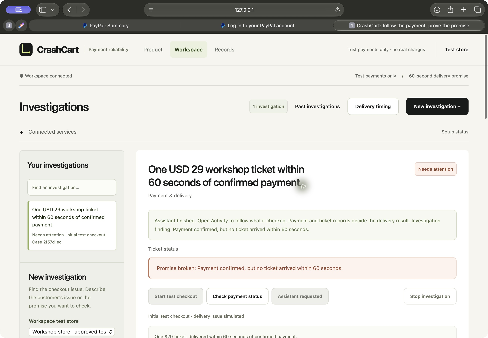

# A new payment, investigated with real AI

On **8 November 2026**, CrashCart created a new USD29 PayPal Sandbox checkout,
the test buyer approved it in Safari, and the server captured the payment.
The owned test store deliberately lost the response and delivered no ticket.
An independent PayPal request confirmed the capture; the unchanged 60-second
delivery check reported **paid but no ticket**.

The background worker then ran DeepSeek-V4.1-Flash on the existing Modal Shared
Endpoint against that **same case**. It made three real model requests:

1. **Check the payment.** With no observations collected, the model requested
   the PayPal record. The tool made a real authenticated Sandbox order read.
2. **Check delivery.** After seeing the completed $29 capture, it requested the
   matching store's ticket records.
3. **Finish with evidence.** It cited the completed capture and the zero-ticket
   observation. Deterministic code retained `FAIL / paid_without_ticket`.

The job finished in the product, survived a page reload, and appeared in the
authenticated Safari workspace. The PayPal timeline filter and actual browser
download were exercised. The downloaded archive's members match the API export.

[Payment, model responses, cited findings, source hashes and allowance receipt](../evidence/runs/submission-ready/live-flow-nov8/proof.json)

## Reproduce with your own accounts

Follow the [full workspace and test-buyer setup](WORKSPACE.md#full-workspace-and-optional-live-test-payments).
Run both API and worker against the same database. Configure your own PayPal
Sandbox app, separate test buyer, and explicitly authorized model access.

For Modal, set the exact owned origin in both `MODAL_BASE_URL` and
`MODAL_ALLOWED_ORIGIN`, use `CRASHCART_MODEL_PROVIDER=modal` and the documented
DeepSeek model, and enable inference only within an authorized allowance.
[Configuration and safeguards](investigator.md#authorization-and-configuration).
The verification used the existing shared allowance ledger in both processes;
it did not create or reset an allowance.

Create an investigation, start the test checkout, approve with the Sandbox buyer,
return to CrashCart, and confirm the approved payment. For a defective test
store, check after the 60-second promise; then choose **Investigate** and follow
the background job. Capture requires an independent `APPROVED` provider read:
return parameters alone cannot establish approval or payment.

## What this proves, and its limits

- This was a **fresh Sandbox payment plus real model execution**, locally. The
  public HTTPS walkthrough still displays recorded examples; it does not host
  the live API, worker or credentials.
- The failure was deliberately configured. This is a known-case integration
  test, not held-out fault discovery or a real Shopify/WooCommerce connection.
- No KERNEL session, webhook registration, public tunnel, checkout video,
  real-money payment or new deployment was included. A result-page browser
  observation was saved **after** inference; the model did not consume login
  pages or that displayed verdict.
- The actual export initially rejected a missing browser observation. The
  validator stayed unchanged; adding the genuinely observed result page allowed
  export. The original rejection is retained.
- The extracted export verifies and reproduces the defect with network
  connections denied. Its **healthy** variant correctly fails
  `ticket_delivered_late`: this run's first independent read occurred after the
  deadline. No clock or rule was changed to turn it into a repair pass. The
  curated early public replay has separate passing comparison tests.
- Three requests consumed USD0.12 of conservative reservations, taking the
  existing meter from **20/24 to 23/24 calls**, USD0.92 reserved. The new calls'
  published token-rate estimate is USD0.0024801; that estimate is not an invoice.
  The prior twenty ledger entries were retained byte for byte under their
  original serialization. There is only **one** authorized call left.
- The inference worker and provider-enabled server were stopped. A local,
  authenticated results reader remains available with payment/model writes
  disabled. No provider keys were placed on the hosted server.

The original acceptance remains **47/60**. This evidence does not close missing
checkout footage, fresh healthy repair, held-out testing, licensed judge access
or release/video requirements.
