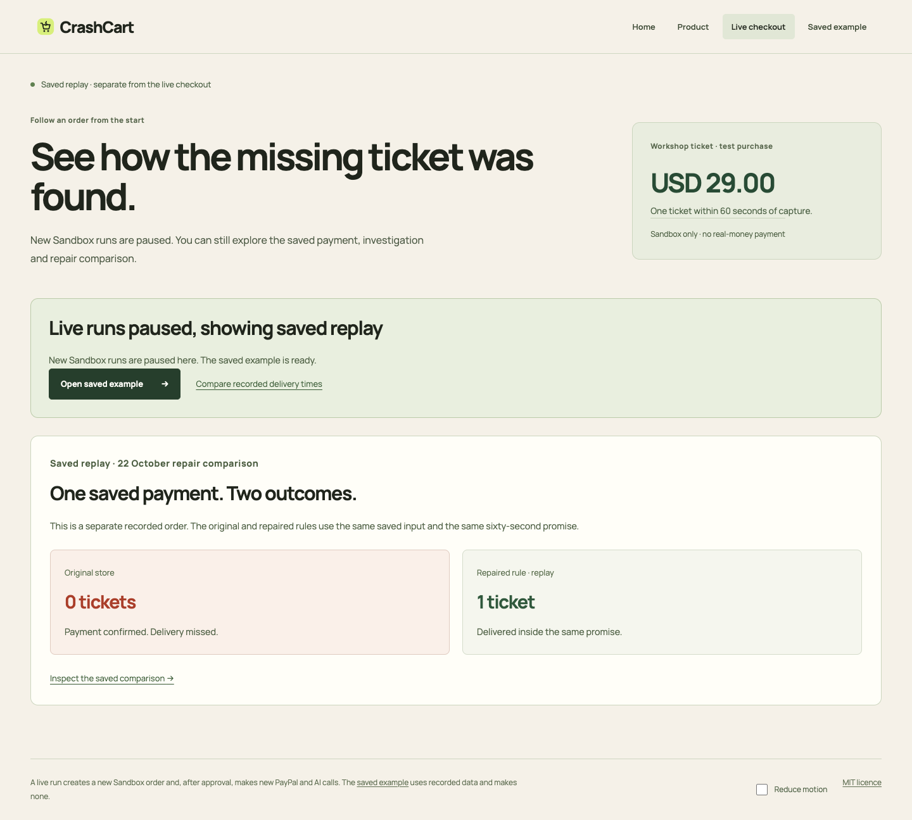
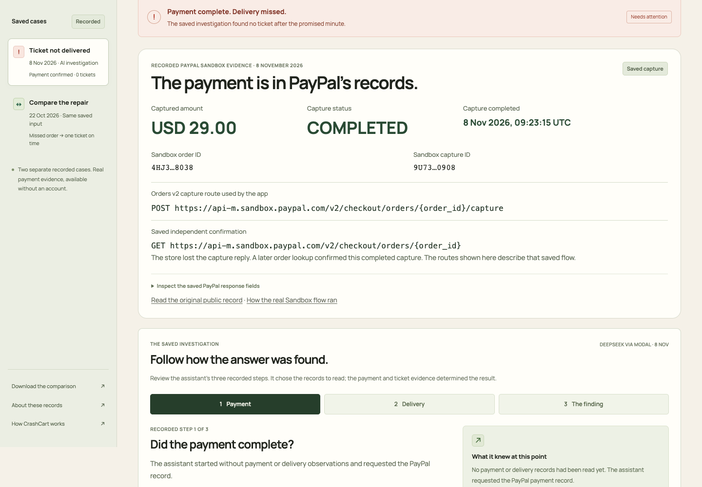
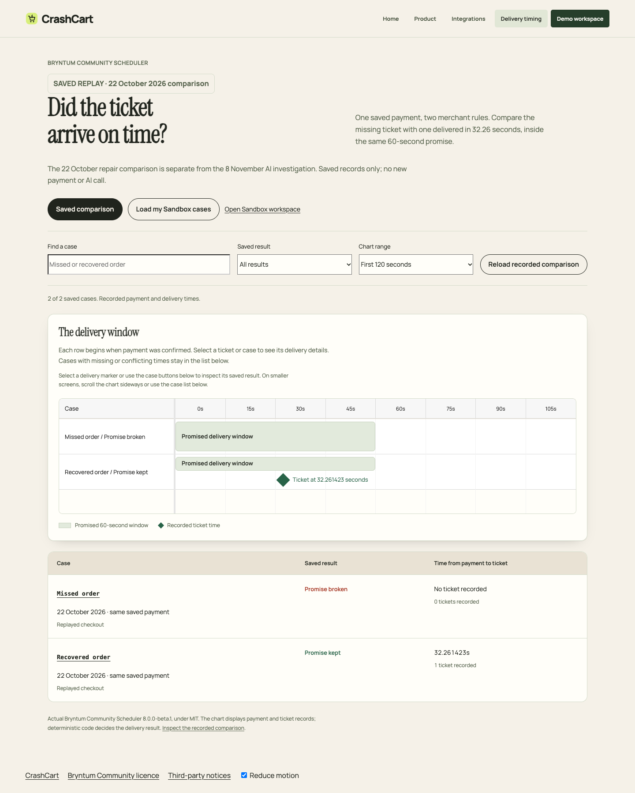

# Public Sandbox candidate — STOP before publication

Prepared 12 November 2026 IST on `codex/judge-live-sandbox-nov11`, based on
`f0c3324500cfdf0c957093503b9056bbcb66fc1b`. The reviewed baseline was published
as [PR #13](https://github.com/himanshu748/crashcart/pull/13), head `5447aab`.
The owner approved its merge, but review identified two return-path bugs and
the known anonymous-session exhaustion risk. Merge was held. The fixes below
are local and uncommitted; nothing further was pushed or changed publicly.
Main and the hosted site remain unchanged.

The live checkout is **implemented and locally tested, not live verified**.
It stays paused until the approved host rollout and real-provider checks pass.

## PR #13 review fixes — local only

- Bare run links and reloads now read the owner's case first, without checking
  new-start availability or dispatching confirmation. Completed results remain
  readable when new starts are disabled.
- Only the explicit `approval_return=1` callback marker on an awaiting-approval
  case requests confirmation. The marker is consumed before requests, so reload
  cannot retry a failed POST. It grants no authority: server ownership, CSRF,
  kill switch and independent PayPal approval still control capture.
- The last admitted checkout can continue with its reserved allowance even
  when new admission is exhausted. An ordinary saved-case view makes GET only.
- Signed two-hour cookies use no anonymous session-table reads or writes.
  520 actual cookieless HTTP requests passed without storage growth. Tampered,
  expired, foreign-secret and legacy unsigned cookies fail closed.
- Real local Chrome regressions reproduced all eight failures at 1440/390px
  before the fix and passed all eight afterward. Their API replies were
  synthetic and intercepted; this is browser behavior proof, not a live payment.
  Fresh actual paused-backend Chrome/Gecko checks also pass at 1440/390/360
  with keyboard/reduced motion and no POST or external request. The initially
  missing pinned Firefox binary was restored into an isolated QA cache; the
  failed setup log remains retained.
- Independent cross-review passed 24 UI tests and nine backend cases; foreign
  owners cannot read or confirm any terminal case. No payment rule, replay
  input, validator, deadline or provider configuration changed.

The current patch changes four runtime/test files, plus this handoff, status
and run log. Existing gallery captures remain actual saved-data UI; no synthetic
successful-run screenshot was substituted into the gallery.

## Ready to inspect

- Separate public entry point: `python3 -m crashcart.public_live --db /absolute/private/workspace.sqlite3`.
  Defaults off, exposes no operator API, and preserves the static keyless path.
- A manual checkout start, independent buyer-approval check, Sandbox capture,
  scoped signed-webhook gate, unchanged sixty-second promise and real bounded
  DeepSeek investigator. Completion requires payment and ticket citations.
- Owner-only sessions and cases; CSRF/origin checks; server-only app/model keys.
  Three starts/IP/hour, eight/day and eight lifetime maximum; three AI calls/run
  with full cost and existing-ledger capacity reserved before a payment starts.
  Failed, cancelled and unknown holds are not refunded. Caps do not grant spend.
- Cheap webhook scope rejection and real token buckets precede provider
  verification. Signature checking itself is unchanged.
- Phase watchdog and detached HTTP-worker parent-death guard. A real local
  streaming subprocess test preserves the unknown model reservation on death.
- Default-paused, timeout and failure UI displays the actual saved comparison.
  No automatic purchase or silent retry. The Bryntum SDK can load the current
  browser's live cases; saved cases remain its default.
- A dedicated fake-money Personal buyer was created and its actual Safari
  Sandbox sign-in verified. Its intentionally shared test credentials are in
  the local README. Merchant app, model and operator credentials are not there.
- One mode line per page, readable saved Orders v2 evidence with shortened IDs,
  PayPal/DeepSeek/Bryntum demo filtering, visible mobile timing, and real current
  light-UI gallery captures. No source payment record or verdict was changed.







## What actually passed

| Command or entry point | Actual result |
| --- | --- |
| `python3.13 -m unittest discover -s tests` | 662 tests / 132.213s / OK |
| Full CI JavaScript group | 152 passed, 0 failed |
| `PYTHON=python3.13 ./scripts/test-judge.sh` | 18 / OK; repeated after copy cleanup |
| Studio deadline / timing tests | 45 / 12 passed |
| Studio build and typecheck | exit 0 |
| `ruff check crashcart` | All checks passed |
| `mypy crashcart` | No issues in 36 source files |
| Foundation / prerequisites | local setup, migration, worker and health pass; no providers configured or contacted |
| Independent safeguard review | 48 scoped tests pass; three blocking findings resolved |
| Default-paused deployment preflight | 47 files; static routes 200; create denied; provider dispatches 0 |
| Actual candidate HTTP scan | 47/47 static files 200; ten private/legacy paths 404 |
| Chrome and Gecko at 1440/390/360 | six actual paused-backend journeys, keyboard and reduced motion pass; no final console/page errors, POST or external request |
| Native macOS Safari | paused comparison and saved masked PayPal evidence render and navigate |
| Isolated local clone plus candidate overlay, empty environment | judge.sh launches; demo and health 200; both replay commands produce expected results |

Canonical commands, repeated in the isolated candidate:

```sh
python3.13 -m crashcart.replay run evidence/runs/paypal-live/early-response-loss-input.json --merchant defective
# exit 1 / FAIL / paid_without_ticket / ticket_count=0 / network_calls=0
python3.13 -m crashcart.replay run evidence/runs/paypal-live/early-response-loss-input.json --merchant healthy
# exit 0 / PASS / ticket_delivered_once_on_time / ticket_count=1 / network_calls=0
```

`crashcart/invariant.py` remains byte-identical. The first full run's old
44-file assertion failed after adding three explicitly allowlisted live assets;
the assertion now requires exactly 47 and retains all boundary/size checks.
The original run remains recorded. Initial capacity, webhook and orphan-worker
regressions failed before their fixes; their fresh passes are separate results.
One initial transient browser resource reset remains recorded; later instrumented
runs passed. These local results do not prove new Sandbox or model execution.

The secret scanner flagged 16 unchanged test fixtures; 15 are explicit test
literals and one is runtime-generated fixture authentication. Its binary/large-file
omissions mean this is not an exhaustive clean secret scan. A separate candidate
cross-check found none of the five configured private project credentials; only
the deliberately shared fake-money buyer password appears, in README alone.
No `.env`, private credential file, ledger or recording is tracked/exported.

## Not passed, and rollout prerequisites

- **Fresh end-to-end live runs: 0/5.** No payment or model call occurred in this
  preparation. Mobile real-device proof was waived by the owner, not passed.
- The previous published head passed its real Linux model-worker death tests
  in CI. The current local patch needs fresh CI after push. Actual systemd
  whole-group stop, proxy-IP behavior and Caddy topology remain unexercised.
  Local Docker is unavailable. Exact-image
  validation and host inspection must happen before enabling any live run.
- Current public `/`, `/product`, `/example`, `/integrations`, `/timing.html`
  and `/healthz` all returned 200. They still serve the existing release.
- This Mac's checked IP is `117.99.78.66`; host SSH currently allows a different
  `/32`. No connection, firewall expansion or networking workaround was tried.
  The existing host plan expressly excludes firewall changes from deploy approval.
- Reconcile the authoritative existing model ledger before transfer or calls.
  Never create/reset a ledger or use a copied stale history to regain allowance.
- The local patch removes anonymous session storage entirely. Its signed cookie
  still expires after two hours; old unsigned preparation cookies fail closed.
  This endpoint has not been deployed, so no live-user migration is claimed.
- The host plan stops if Caddy is bridged; it does not broaden the backend bind.
  A reviewed topology alternative would need a new exact plan before deployment.

[Prepared deploy, private configuration and rollback](PUBLIC_LIVE_HOST_PLAN.md).
No new paid resources, card, billing change, model limit increase or KERNEL run.
If reliable live proof is absent by **12 November 21:00 IST**, retain the kill
switch and publish only the independently verified presentation fixes.
Historical CC acceptance remains **47/60**, with no requirement closed here.

## External action queue — one exact submit per action

The source and host access prerequisites precede the requested publication queue:

1. **Next proposed action:** commit and push the reviewed fixes to existing
   PR #13 only. No new PR, main change, host change or submission edit.
2. Read fresh CI/review results, then merge only after a separate exact `submit`.
   The earlier merge grant was held; it did not publish this changed patch.
3. Temporarily permit this Mac's freshly checked single IP on SSH, perform only
   strict-host-key read-only topology/version inspection, then remove only that
   new rule. Requires a separate explicit access approval; not bundled into deploy.
4. **Deploy:** present the inspected exact plan and immutable merged SHA first;
   after its own approval, deploy the static presentation/live API paused with
   rollback, validate Linux/Caddy/proxy behavior, and stop. Credential transfer,
   one scoped Sandbox webhook and activation must be included explicitly in the
   reviewed rollout before any real call. Do not improvise a topology change.
5. **Devpost text / README links:** only after real-flow results are known, prepare
   exact wording, preserving recorded-versus-live truth; save once after its gate.
6. **Gallery:** replace the old images with the actual light captures after approval.
7. **YouTube captions:** last verified cleanup completed 11 November 20:46 IST:
   manual Draft, automatic absent, audio unchanged, signed-out playback checked.
   Read current inventory first; do not repeat removal if it remains correct.
8. **Old video:** previously recorded as Unlisted. Read back before proposing any
   visibility change; do not change a setting already correct.

No public video re-cut or upload is proposed. No AG Grid question, sponsor tick,
new submission, public post, tag, branch deletion or other service change is in
this queue. Five genuine desktop successes plus kill/failure checks remain
necessary before claiming the live feature works reliably.
