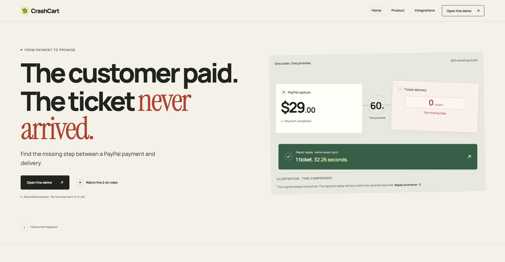

# Landing and motion — local review

10 November 2026, 19:07 IST. Branch: `ui-motion-nov10`. Runtime tested: `d980422`. Separate release gate: `d99f47b`. Nothing public changed; remote main remains `f703225`.

## What changed

The public landing starts with the customer problem, a time-compressed payment-to-delivery illustration and two clear actions. A desktop scroll story follows the missing ticket, saved AI investigation, repaired rule and actual Bryntum screenshot. Small screens keep readable content without pinning. The recorded badge stays near the main action; the footer explains the separate saved cases. Product and demo gain entrance, selection and timing feedback. No recorded values, payment rules, replay logic, fixtures or invariant bytes changed.

Everything is self-hosted: GSAP/ScrollTrigger 3.15.1 with their standard licence, two OFL fonts and two compressed product screenshots. No tracker or CDN. `font-src 'self'` is the only prepared CSP addition. The workspace namespace now shares the exact public presentation allowlist with judge mode; its first-run 503 was fixed without changing private-route protection or memory limits.

## Before and after

Each bitmap has the requested browser width and 1000px height. These are actual page captures.

| Width | Existing public landing | Candidate |
| --- | --- | --- |
| 375 | [Before](images/ui-motion-nov10/home-before-375.jpg) | [After](images/ui-motion-nov10/home-after-375.jpg) |
| 768 | [Before](images/ui-motion-nov10/home-before-768.jpg) | [After](images/ui-motion-nov10/home-after-768.jpg) |
| 1280 | [Before](images/ui-motion-nov10/home-before-1280.jpg) | [After](images/ui-motion-nov10/home-after-1280.jpg) |
| 1920 | [Before](images/ui-motion-nov10/home-before-1920.jpg) | [After](images/ui-motion-nov10/home-after-1920.jpg) |



Recorded Example, Product and Integrations also fit at 375, 768, 1280 and 1920px, with document width equal to viewport width. Interaction checks covered keyboard skip focus, scenario and AI controls, one-click repair selection, forward/reverse story transitions and the page motion toggle. [Actual browser reduced-motion capture](images/ui-motion-nov10/reduced-motion-1280.png): all four panels remain visible, unpinned and unanimated under OS media emulation.

Local preview: `http://127.0.0.1:8911/`.

## Scroll video

Local ignored artifact: `dist/crashcart-landing-motion-20s.mp4`.

- Actual Playwright 1.65.0 browser recording, trimmed to consecutive source seconds 1.8–21.8. No montage, generated scenes, replacement data or artificial clock.
- 1920×1080, 20.000 seconds, 500 frames at 25fps, 5,751,904 bytes, no audio. Full decode passed; investigation, repair and sponsor frames inspected.
- Browser animation cadence: 1,288 samples, median 16.7ms, p95 16.7ms, maximum 33.4ms, one interval over 25ms. This measures one isolated browser session; the 25fps video encoder is distinct from animation cadence.
- No page errors or external page requests. Failed native-control recordings are retained separately. The existing YouTube video is unchanged.

## Performance

Official Lighthouse 13.6.0 against the final-runtime clean clone, using default mobile and desktop presets, with reporting uploads disabled. Every required script returned 200.

| Audit | Mobile | Desktop |
| --- | ---: | ---: |
| Performance | 100 | 100 |
| Accessibility | 100 | 100 |
| Best Practices | 100 | 100 |
| SEO | 100 | 100 |
| LCP | 1352.46ms | 474.26ms |
| Initial transfer | 328,903 bytes | 328,903 bytes |

All 22 public presentation assets total 408,128 bytes, including lazy media and the other public pages. The 1.5MB gate passes. Initial failed audits remain retained; no threshold, throttle or validator was loosened.

## Fresh-clone checks

Runtime and tests in subsequent release/documentation commits are byte-identical to the tested `d980422` clone.

```sh
python3 -m unittest discover -v
# Ran 598 tests in 133.537s — OK
./scripts/test-judge.sh
# Ran 17 tests in 3.005s — OK
node --test tests/test_workspace_api.cjs tests/test_background_ui.cjs tests/test_judge_ui.cjs tests/test_site_illustration.cjs tests/test_judge_motion.cjs
# 97 tests, 97 pass, 0 fail
ruff check crashcart
# All checks passed!
mypy crashcart --ignore-missing-imports
# Success: no issues found in 33 source files
npm ci --ignore-scripts --prefix studio
npm run build --prefix studio
npm run test:deadlines --prefix studio     # 45 pass
npm run test:presentation --prefix studio  # 7 pass
npm run test:recorded --prefix studio      # 6 pass
```

Compile, existing JS syntax, foundation and prerequisites checks also pass. An independent reviewer reran 13 namespace/asset tests and found no blocker. The retained first full run failed 1/598 because the workspace rejected the expanded bundle; that same test now passes.

A separate fresh clone without `.env` or Node packages runs:

```sh
./scripts/judge.sh --no-open --port 8911
```

Landing, product, example, health, font and vendor-script responses return 200. No keys, licence or installation is needed. The replay commands remain:

```sh
python3 -m crashcart.replay run evidence/runs/paypal-live/early-response-loss-input.json --merchant defective
# exit 1 / FAIL / paid_without_ticket / 0 tickets / network_calls=0
python3 -m crashcart.replay run evidence/runs/paypal-live/early-response-loss-input.json --merchant healthy
# exit 0 / PASS / ticket_delivered_once_on_time / 1 ticket / network_calls=0
```

## What remains gated

New-head GitHub CI is **pending**: it requires the branch push that the owner gated. Local CI-equivalent checks do not establish remote CI. The manual Pages workflow is also unverified on GitHub; its YAML, shell syntax and five local synthetic latest-CI guard cases pass. No public host has this candidate yet.

The next exact `submit` authorizes **only**:

```sh
git push origin ui-motion-nov10
```

Then read the new-head CI results and stop before opening a PR. Opening the PR, merging, deploying the dedicated host and manually publishing Pages each need their own exact `submit`, following the owner's one-action gate. Pages will not auto-publish from the proposed merge. No Devpost or YouTube change is proposed.

Historical 47/60 is unchanged; no CC requirement was closed. [Run log](UI_MOTION_RUN_LOG.md) records failures, fixes and tested scope. No payment, model or KERNEL call, paid service, licence key or secret is part of this work.
